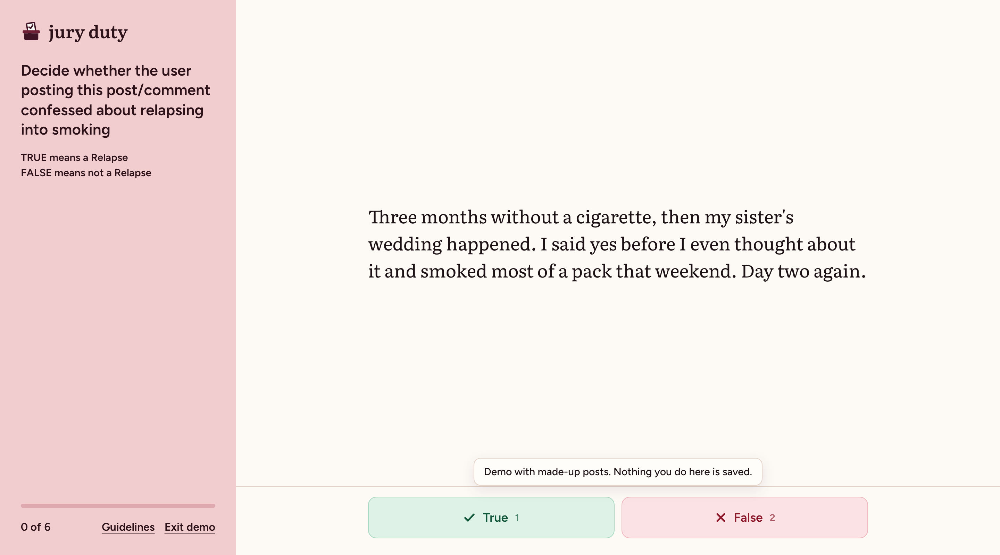
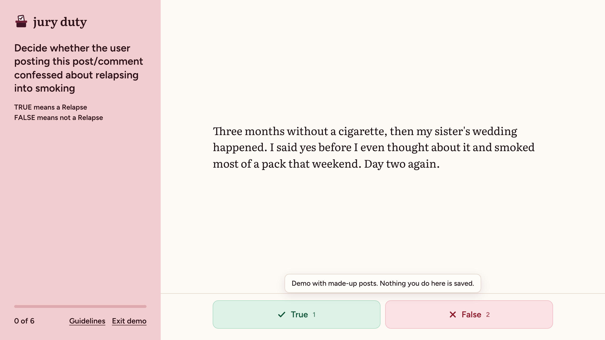
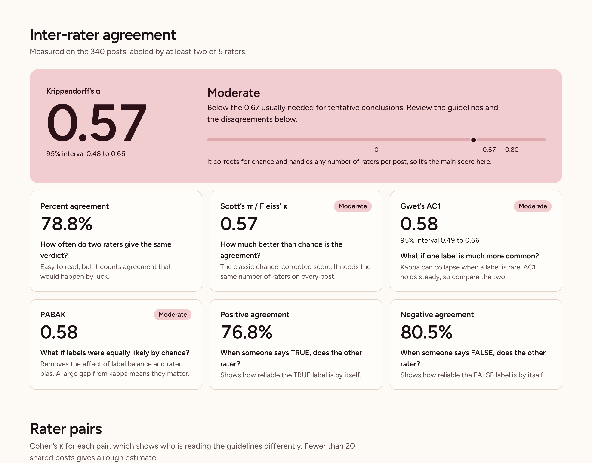

<!-- markdownlint-disable MD033 -->

<p align="center">
  
</p>

## Jury Duty

Jury Duty is a self-hosted app for getting a group of people to label a dataset by hand, and measuring whether they agree.

Research and machine learning often need humans to read thousands of pieces of text and make the same yes-or-no call. Doing that in a spreadsheet goes wrong quickly: raters collide, posts get skipped, and nobody knows whether the labels can be trusted. Jury Duty gives each rater one post at a time, records an independent TRUE or FALSE verdict, and shows the project owner how reliable the results are.

**Try the [demo](https://juryduty.hishaam.dev/demo), no sign-in needed.**

[juryduty.hishaam.dev](https://juryduty.hishaam.dev) is one deployment of Jury Duty, built for a research project where 12 raters made more than 12,000 judgements on Reddit posts about quitting smoking. Your own deployment runs your own dataset and guidelines.

## How It Works

1. **Set it up.** Host your own copy, write your guidelines, and import your posts from a CSV.
2. **Invite raters.** They sign in with Google and get one post at a time, with the guidelines a click away.
3. **Collect verdicts.** Every rater judges independently and never sees anyone else's answer.
4. **Check the results.** Owners see how far raters agree, where they differ, and can export everything to CSV.

<p align="center">
  
</p>

## What It Does

For raters:

- Shows one post at a time, from a single line to several screens, with True and False always in the same place
- Assigns posts so raters don't collide, and gives each rater a post at most once
- Works by click, tap or keyboard, on desktop and phone
- Saves every verdict safely, keeps the post on screen if a save fails, and allows undo for 10 minutes
- Reminds raters to take a break, because labeling sensitive content for hours is tiring

For owners:

- Shows progress, each rater's workload and TRUE rate, and the posts raters disagreed on
- Measures inter-rater agreement with Krippendorff's α, Scott's π, Fleiss' κ, Cohen's κ for each rater pair, Gwet's AC1 and PABAK, with confidence intervals and a plain-language reading
- Exports every verdict to CSV for your own analysis

<p align="center">
  
</p>

## Tech Stack

[](https://svelte.dev/docs/kit)
[](https://svelte.dev/)
[](https://www.typescriptlang.org/)
[](https://supabase.com/)
[](https://www.postgresql.org/)
[](https://vercel.com/)
[](https://vitest.dev/)
[](https://playwright.dev/)

## Self-Hosting

[](https://vercel.com/new/clone?repository-url=https%3A%2F%2Fgithub.com%2Fmdhishaamakhtar%2Fjury-duty&root-directory=frontend&env=PUBLIC_SUPABASE_URL,PUBLIC_SUPABASE_ANON_KEY,SUPABASE_SERVICE_ROLE_KEY&envDescription=Find%20these%20in%20your%20Supabase%20project%20settings&project-name=jury-duty&repository-name=jury-duty)

The [self-hosting guide](./docs/self-hosting.md) takes you from an empty Supabase project to a running deployment. It covers the database, Google sign-in, your guidelines, importing posts, adding owners, and reading the results.

## Quick Start

You need Docker, Node.js 24 and the [Supabase CLI](https://supabase.com/docs/guides/local-development/cli/getting-started). This starts a local database with every migration applied:

```bash
export GOOGLE_CLIENT_ID=local GOOGLE_CLIENT_SECRET=local
supabase start
supabase status -o env
```

Copy `frontend/.env.example` to `frontend/.env` and fill in the local URL and keys, then start the app:

```bash
cd frontend
npm install
npm run dev
```

Open [localhost:5173/demo](http://localhost:5173/demo). Google sign-in needs real credentials, which the [self-hosting guide](./docs/self-hosting.md) explains.

To run the checks:

```bash
npm run verify
```

## Contributors

- Md Hishaam Akhtar

## License

Jury Duty is licensed under the [GNU General Public License v3.0](./LICENSE).
